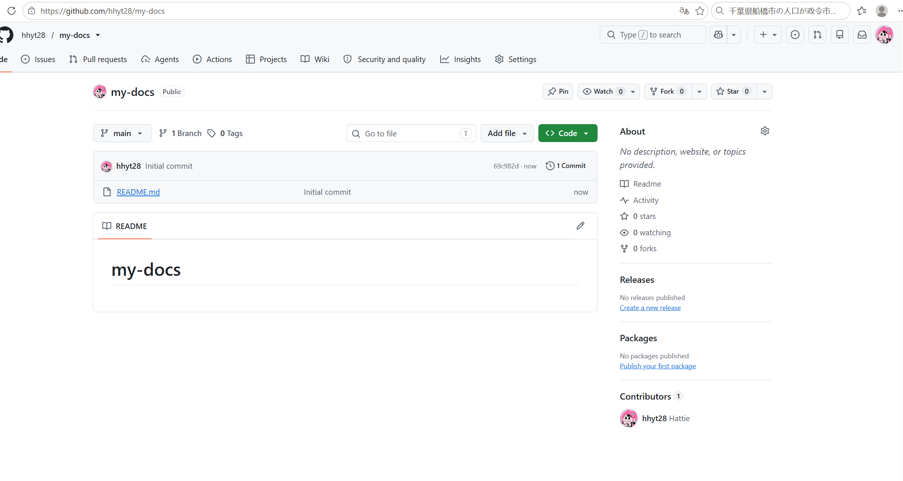
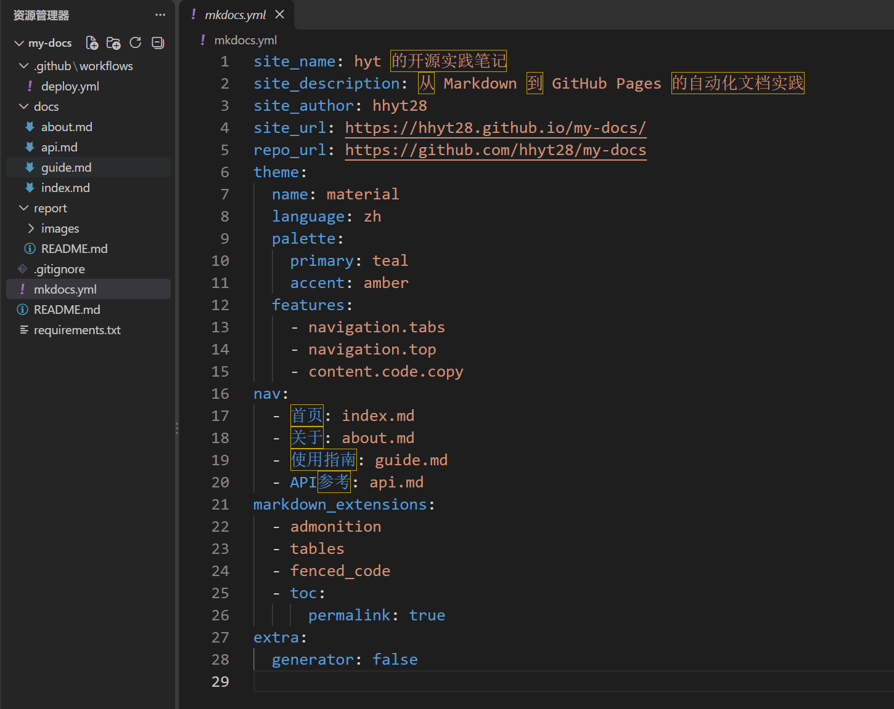
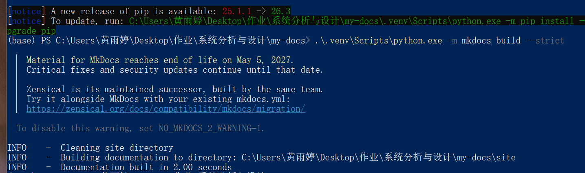
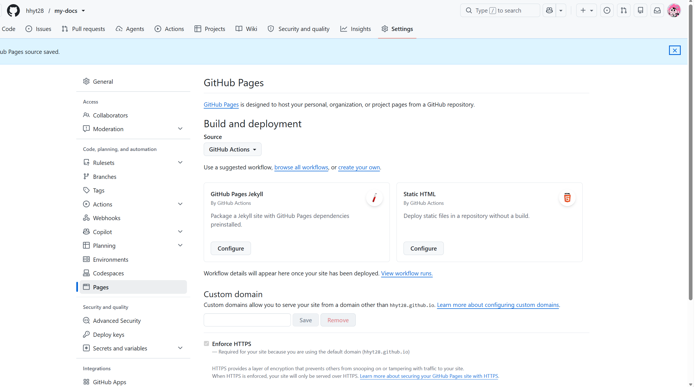
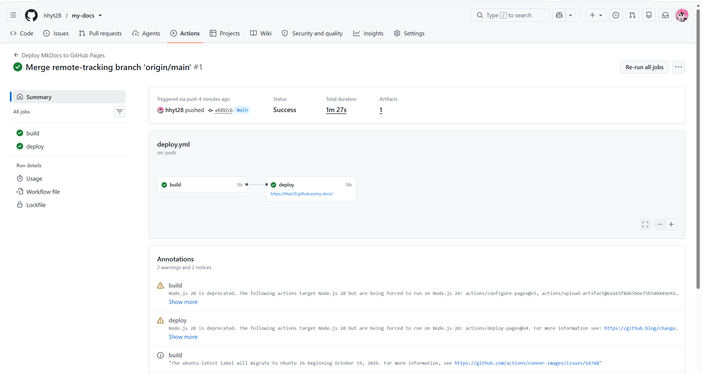
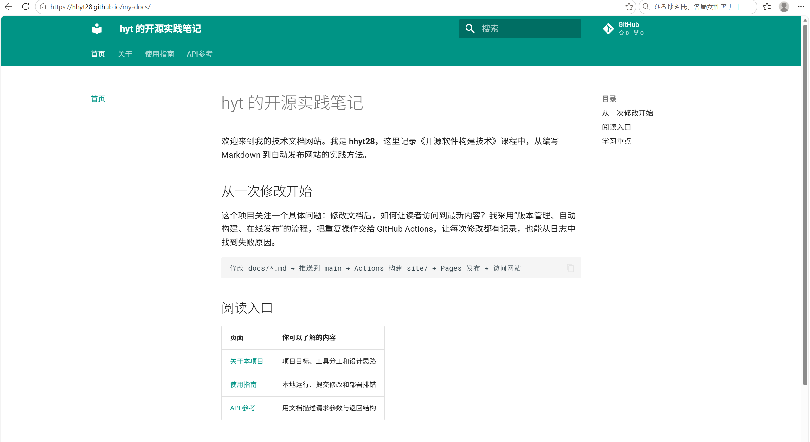
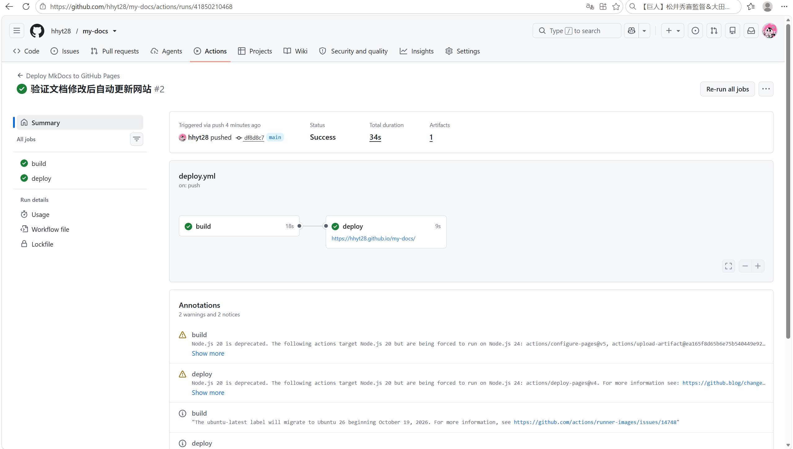
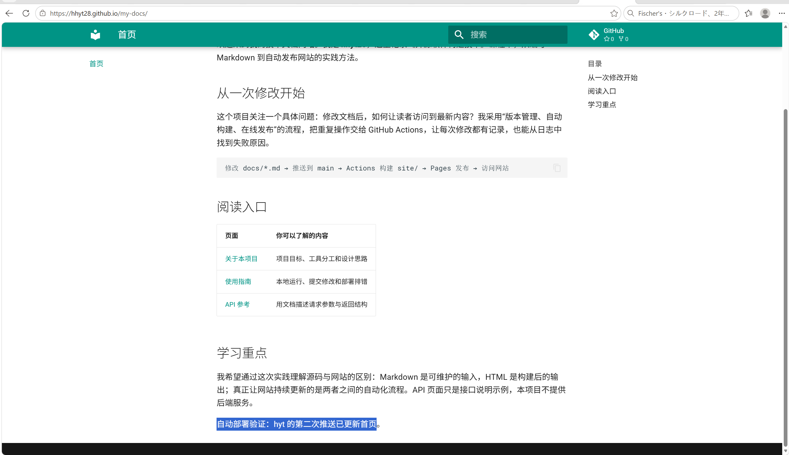

# 通过 GitHub Actions 自动部署静态文档到 GitHub Pages 实验报告

## 1. 基本信息与实验目标

- 课程：开源软件构建技术
- 实践项目：02-github-pages
- GitHub 登录名：`hhyt28`
- 网站名称：hyt 的开源实践笔记
- 实验日期：2026年11月4日
- 个人源码仓库：[hhyt28/my-docs](https://github.com/hhyt28/my-docs)
- 个人报告地址：[report/README.md](https://github.com/hhyt28/my-docs/blob/main/report/README.md)
- 最终网站地址：[hyt 的开源实践笔记](https://hhyt28.github.io/my-docs/)

本次实验以个人公开仓库为基础，使用 Markdown 和 MkDocs Material 搭建四页技术文档网站，通过 GitHub Actions 自动构建并发布到 GitHub Pages。实验不仅检查首次发布是否成功，还通过再次修改首页并推送，验证“文档修改—推送源码—自动构建—自动部署—网站更新”的完整流程。

实验结果是：四页网站可以访问，首次和第二次部署均成功；第二次运行由 push 触发，公开首页已经出现与第二次提交对应的新增文字。下文通过截图、提交记录和 Actions 运行链接说明实践过程。

## 2. 实验环境与项目结构

### 2.1 实验环境

| 项目 | 实际使用情况 |
| --- | --- |
| 本地操作系统与终端 | Windows、PowerShell |
| Git | 2.55.0.windows.2 |
| 本地 Python | 初始终端显示 Anaconda Python 3.13.5，随后使用该解释器创建项目虚拟环境 |
| Python 依赖管理 | 项目内 `.venv` 虚拟环境，通过 pip 安装 `requirements.txt` |
| 文本编辑器与浏览器 | Visual Studio Code、Microsoft Edge |
| 文档构建与主题 | MkDocs、MkDocs Material |
| 云端运行环境 | `ubuntu-latest`，工作流固定使用 Python 3.12 |
| 发布服务 | GitHub Actions 与 GitHub Pages |

本地 Python 与云端 Python 版本不同，因此分别验证本地构建和云端工作流的结果。两次云端运行均成功，说明本次提交在工作流指定的 Python 3.12 环境中完成了构建与发布。

### 2.2 项目结构

```text
my-docs/
├── .github/
│   └── workflows/
│       └── deploy.yml
├── docs/
│   ├── index.md
│   ├── about.md
│   ├── guide.md
│   └── api.md
├── report/
│   ├── README.md
│   └── images/
├── mkdocs.yml
├── requirements.txt
├── .gitignore
└── README.md
```

网站正文与实验报告分开维护：`docs/` 用于构建公开网站；`report/` 保存实验过程说明和实际截图。根目录 README 提供项目简介、网站链接、报告入口及本地预览命令。生成目录 `site/`、虚拟环境 `.venv/` 和 Python 缓存已加入 `.gitignore`，不作为源码上传。

## 3. 实践过程与关键截图

### 3.1 创建个人公开仓库

我使用本人 GitHub 账号 `hhyt28` 创建 `my-docs` 仓库，设置为 Public，并确认默认分支为 `main`。公开仓库便于教师查看源码、工作流、提交历史和实验报告；统一使用 `main`，可以与工作流的分支触发条件保持一致。

创建后的仓库首页显示所有者 `hhyt28`、仓库名称 `my-docs` 及 Public 标识，默认分支为 `main`，初始包含 README 文件，如图1所示。



*图1 个人公开仓库首页*

### 3.2 编写四页文档并配置 MkDocs

我在 `docs/` 中组织四页正文，使各页有明确用途，并通过导航和正文链接连接起来。

| 页面 | 文件 | 主要内容 |
| --- | --- | --- |
| 首页 | `index.md` | 个人文档站介绍、自动发布流程、阅读入口和学习重点 |
| 关于 | `about.md` | 项目目标、工具与目录的分工、内容设计思路 |
| 使用指南 | `guide.md` | 本地安装与预览、提交部署流程、自动更新验证和排错顺序 |
| API参考 | `api.md` | 示例接口的请求方法、查询参数、成功响应与错误约定 |

四页均包含实质内容。首页和关于页使用表格说明阅读入口与工具分工；指南页提供终端命令；API 页提供 HTTP 请求、JSON 响应及参数表，并明确这些接口仅用于文档展示，不提供真实后端服务。正文还设置了页面间链接，方便读者继续阅读。

`mkdocs.yml` 配置网站名称、作者、网站地址、源码仓库地址、中文 Material 主题及四页导航。主要导航配置为：

```yaml
site_name: hyt 的开源实践笔记
site_url: https://hhyt28.github.io/my-docs/
repo_url: https://github.com/hhyt28/my-docs
nav:
  - 首页: index.md
  - 关于: about.md
  - 使用指南: guide.md
  - API参考: api.md
```

其中，`docs/` 保存人工维护的 Markdown；`nav` 决定导航文字及对应文件，路径相对于 `docs/`，不能再加一层 `docs/` 前缀；`site/` 是构建生成的静态网站目录，不需要手工修改。网站采用青绿色主色，启用顶部标签导航、返回顶部及代码复制功能，便于阅读技术说明。项目目录与配置如图2所示。



*图2 项目目录与 MkDocs 配置*

### 3.3 建立虚拟环境并完成本地构建与预览

最初直接运行虚拟环境中的 Python 时，PowerShell 提示找不到程序。检查后发现项目中尚无 `.venv`，因此先创建虚拟环境并安装依赖，再执行严格构建：

```powershell
python -m venv .venv
.\.venv\Scripts\python.exe -m pip install -r requirements.txt
.\.venv\Scripts\python.exe -m mkdocs build --strict
```

`requirements.txt` 将 MkDocs 限定为 `>=1.6,<2`，Material 主题限定为 `>=9.6,<10`。通过项目虚拟环境解释器执行命令，无需激活 PowerShell 脚本，也能明确使用项目依赖。

本次严格构建成功。截图中的终端显示生成目录为 `my-docs/site`，并输出 `Documentation built in 2.00 seconds`，如图3所示。



*图3 本地严格构建成功*

构建成功后，我执行以下命令启动本地预览：

```powershell
.\.venv\Scripts\python.exe -m mkdocs serve
```

终端实际显示预览地址为 `http://127.0.0.1:8000/my-docs/`。访问根路径时浏览器会被重定向到项目路径。我逐一打开首页、关于、使用指南和 API 参考，检查导航、表格、代码块和页面间链接，结果正常。检查结束后使用 `Ctrl+C` 停止预览服务。

### 3.4 设置 Pages 发布来源并检查 Actions 权限

在个人仓库进入 `Settings → Pages → Build and deployment`，将 Source 设置为 **GitHub Actions**，并确认设置已经保存，如图4所示。这使网站由工作流上传的产物发布，而不是从某个分支读取生成文件。



*图4 GitHub Pages 发布来源设置*

随后进入 `Settings → Actions → General`，核对仓库已允许使用全部 Actions 和可复用工作流，即选中 `Allow all actions and reusable workflows`。部署所需权限在工作流中单独声明，无需将仓库默认权限改为全局读写，也无需开启创建或批准 PR 的权限。

### 3.5 配置工作流并完成首次自动部署

部署配置保存在 [deploy.yml](../.github/workflows/deploy.yml)。工作流分为 `build` 和 `deploy` 两个任务。

`build` 依次获取源码、设置 Python 3.12、配置 Pages、安装依赖、运行 `python -m mkdocs build --strict`，最后将 `site/` 上传为 Pages 产物。`deploy` 使用 `needs: build` 等待构建成功，再通过官方部署动作发布网站。

工作流关键配置含义如下：

| 配置 | 本次实验中的作用 |
| --- | --- |
| `push.branches: [main]` | 只对 main 分支的推送应用自动触发条件 |
| `push.paths` | 限定为正文、MkDocs 配置、依赖清单及部署工作流的修改 |
| `workflow_dispatch` | 提供手动运行入口，便于重试和排错；本次两次验证均由 push 触发 |
| `needs: build` | 保证构建成功后才执行部署 |
| `contents: read` | 允许工作流读取仓库源码 |
| `pages: write` | 允许部署任务发布 GitHub Pages |
| `id-token: write` | 允许部署任务获取 OIDC 身份令牌，供官方 Pages 部署验证身份 |
| `environment: github-pages` | 将部署关联到 github-pages 环境，记录部署结果及网站地址 |
| `concurrency` | 使用 pages 并发组协调部署，且不自动取消进行中的运行 |

本地仓库与远程仓库分别已有初始提交，因此我先关联远程仓库、获取远程历史，再合并远程初始化提交。合并 README 时，使用 `-X ours` 对冲突部分优先采用本地内容，同时保留远程提交历史。执行的关键命令为：

```powershell
git remote add origin https://github.com/hhyt28/my-docs.git
git fetch origin
git merge origin/main --allow-unrelated-histories -X ours --no-edit
git push -u origin main
```

推送后自动触发首次运行。运行标题为 `Merge remote-tracking branch 'origin/main'`，编号为 #1，触发事件为 push，总状态为 Success，`build` 和 `deploy` 均显示绿色对勾，总用时为1分27秒，如图5所示。

- [首次部署对应提交 efd92c6](https://github.com/hhyt28/my-docs/commit/efd92c6bf97b4d73d1a4ee5467383301ea5b7c73)
- [首次成功的 Actions 运行 #1](https://github.com/hhyt28/my-docs/actions/runs/41847557988)



*图5 首次自动构建与部署成功*

### 3.6 访问公开网站并检查四页导航

我从部署记录取得网站地址，访问 `https://hhyt28.github.io/my-docs/`，确认浏览器打开的是 GitHub Pages 公开地址。项目网站带有 `/my-docs/` 路径，不能只使用账号站点根地址。公开首页如图6所示，截图保留浏览器地址栏。



*图6 GitHub Pages 公开网站效果*

网站访问与导航检查情况如下：

| 检查对象 | 检查内容 | 结果 |
| --- | --- | --- |
| 首页 | 个人介绍、流程代码块、阅读入口表格 | 显示正常 |
| 关于 | 项目目标、工具分工表格及正文链接 | 显示与跳转正常 |
| 使用指南 | 命令代码块、操作步骤、排错表格 | 显示正常 |
| API参考 | 参数表、HTTP 与 JSON 示例、接口说明 | 显示正常 |
| 导航及页面间链接 | 四页切换、正文相对链接与资源加载 | 检查通过 |

### 3.7 第二次推送与自动更新验证

首次发布成功后，我在本地 `docs/index.md` 末尾新增以下内容：

```text
自动部署验证：hyt 的第二次推送已更新首页。
```

保存后检查暂存差异，确认修改内容为首页新增文字，再提交并推送：

```powershell
git add docs/index.md
git diff --staged
git commit -m "验证文档修改后自动更新网站"
git push origin main
```

本次提交编号为 `df8d8c7`。推送后，Actions 自动生成编号为 #2 的运行，标题为“验证文档修改后自动更新网站”，页面显示 `Triggered via push`；没有使用手动运行替代本次自动更新验证。该运行总状态为 Success，`build` 和 `deploy` 均成功，总用时34秒，如图7所示。

- [第二次更新对应提交 df8d8c7](https://github.com/hhyt28/my-docs/commit/df8d8c71d6de091b1dc24f58b757bed7129eab9d)
- [第二次 push 自动部署成功的 Actions 运行 #2](https://github.com/hhyt28/my-docs/actions/runs/41850210468)



*图7 第二次推送自动触发部署成功*

运行成功后，我刷新公开首页，在“学习重点”下方看到新增的验证文字，内容与本次提交一致，如图8所示。由此可将本地修改、Git 提交、push 触发的运行和公开网页的变化对应起来，验证后续文档修改能够自动发布。



*图8 第二次推送后网站内容更新*

## 4. 实际问题与解决过程

### 4.1 虚拟环境不存在导致无法执行构建命令

**现象：**执行 `.\.venv\Scripts\python.exe -m mkdocs build --strict` 时，PowerShell 报 `CommandNotFoundException`，提示无法识别指定程序。

**排查：**执行 `Test-Path .\.venv\Scripts\python.exe`，结果为 `False`；再执行 `Get-ChildItem .\.venv -Force`，提示目录不存在。由此判断命令尚未进入 MkDocs 构建阶段，问题是虚拟环境缺失。

**解决：**运行 `python -m venv .venv` 创建环境，通过其中的 Python 安装 `requirements.txt`，再执行严格构建。最终得到图3的成功日志。

**体会：**应先确认解释器路径和依赖，再检查网站配置，避免把环境错误误认为 Markdown 或 YAML 错误。

### 4.2 本地预览持续运行导致终端不能直接输入下一条命令

**现象：**网页检查完成后，终端仍显示 `Watching paths for changes`、`Serving on ...` 和浏览器连接日志，没有返回 PowerShell 提示符。

**原因：**`mkdocs serve` 是持续运行的开发服务，会监听文件变动并提供预览，这种状态属于正常行为。

**解决：**在终端按 `Ctrl+C`，出现 `Shutting down...` 并返回提示符后，再执行 Git 命令。停止服务只结束本地预览，不会删除源码或已经发布的网站。

### 4.3 本地与远程仓库分别存在初始化提交

**情况：**本地已有网站源码提交，而远程仓库已经包含独立的 `Initial commit` 和 README。两边的历史没有共同祖先，需要先整合后推送。

**处理：**执行 `git fetch origin`，再使用 `git merge origin/main --allow-unrelated-histories -X ours --no-edit` 合并历史。终端显示 `Auto-merging README.md` 和 `Merge made by the 'ort' strategy`，随后推送成功。没有使用强制推送覆盖远程历史。

### 4.4 本地与云端的版本提示

本地构建输出包含 Material for MkDocs 的维护周期提示；云端运行摘要包含部分 Actions 所用 Node.js 运行时的弃用提示及 runner 镜像迁移通知。两次运行的最终状态均为 Success，提示没有造成此次构建或发布失败。

我核对了最终任务状态和公开网站的访问结果，确认本次部署成功。后续维护时，需要继续关注相关 Actions 和主题的版本变化，并在更新配置后重新验证构建与部署。

### 4.5 日志与配置核对

本次核对了 Pages 来源为 GitHub Actions、默认分支为 main、仓库允许使用所需 Actions、工作流路径匹配规则、严格构建结果及两个任务的成功状态。对于自动更新，还核对了第二次提交编号、push 触发事件和公开网页新增文字，避免将首次成功记录误当成第二次更新证据。

## 5. 原理理解

### 5.1 docs/ 和 site/ 各保存什么？为什么不用手工修改 site/？

`docs/` 保存人工维护的 Markdown 源文档；`site/` 保存 MkDocs 根据正文、配置和主题生成的 HTML、CSS、JavaScript 等静态文件。重新构建会重新生成网站输出，因此直接修改 `site/` 容易在下一次构建时丢失。正确做法是修改 `docs/` 或 `mkdocs.yml`，通过构建得到新的 `site/`。本项目将生成目录加入 `.gitignore`，由工作流上传构建产物。

### 5.2 本次工作流在什么情况下自动运行？

工作流在向 `main` 分支推送，且变更文件匹配以下任一路径时自动运行：`docs/**`、`mkdocs.yml`、`requirements.txt` 或 `.github/workflows/deploy.yml`。分支条件和文件路径条件需要同时满足。

此外，`workflow_dispatch` 提供手动运行入口，可用于重试或排错，但本次自动更新验收使用的是修改正文后的 push 事件。两次实际运行的页面都显示由 push 触发。

### 5.3 build 与 deploy 两个任务有什么区别？

`build` 负责将源码转换为可发布的产物，包括获取源码、准备 Python、安装依赖、严格构建和上传 `site/`。`deploy` 负责将已经构建成功的产物发布到 GitHub Pages，使其可以通过公开网址访问。

二者通过 `needs: build` 建立先后关系，只有构建成功，部署任务才会继续。这样的分工便于判断失败发生在依赖安装、文档构建还是网站发布阶段。

### 5.4 只修改 report/README.md 会触发部署吗？为什么？

不会。`report/README.md` 不在本工作流 `push.paths` 的匹配范围内，报告截图也不属于网站正文。仅修改根目录 `README.md` 同样不会触发。若同一次提交还修改了匹配条件的网站文件，则会因这些文件的变化而触发部署。限定路径可以减少与网站无关的重复构建。

### 5.5 本次方案为何无需创建 gh-pages 分支？

本次 Pages 来源设为 GitHub Actions。构建任务使用 `actions/upload-pages-artifact` 上传 `site/`，部署任务再使用 `actions/deploy-pages` 发布该产物。生成文件通过 Actions 产物传递，不依赖从某个发布分支读取文件，因此无需创建 `gh-pages` 分支，也不需要将静态输出提交到该分支。

### 5.6 源码、构建产物、工作流与托管网站的关系

源码是人工维护的正文与配置，构建产物是工具根据源码生成的可浏览文件，工作流负责自动执行转换和发布，Pages 负责托管并响应访问请求。它们的关系为：

```text
Markdown 正文与配置
        ↓ Git 推送到 main 且满足路径条件
GitHub Actions 安装依赖并运行严格构建
        ↓
生成并上传 site/ 产物
        ↓ build 成功后运行 deploy
GitHub Pages 托管网站
        ↓
浏览器访问并核对最新内容
```

## 6. 实验体会

通过这次实验，我把文档源码与网页效果联系起来，也理解了“文件已经推送”与“网站已经发布”需要分别确认。源码进入仓库后，还应检查 Actions 是否被触发、构建与部署是否成功，以及浏览器是否显示对应内容。

本次虚拟环境缺失的问题说明，排错应从最早失败的环节开始：先确认程序路径和依赖，再检查构建配置与网页链接。第二次推送验证则让我看到，自动化流程可以重复运行；提交编号和运行记录使网站更新过程可以追溯。今后维护文档时，我会先本地检查，再提交修改，最后核对部署记录和公开页面。
